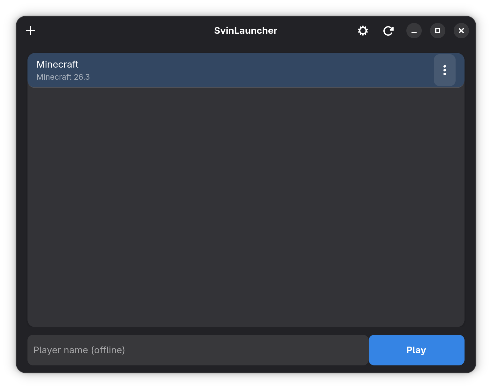

# SvinLauncher

<p align="center"></p>

A lightweight **Minecraft: Java Edition** launcher for GNOME, built with GTK4 and libadwaita.

Create vanilla instances, download game files from Minecraft servers, and launch the game directly through Java - no external launcher required.

<p align="center"></p>

## Features

- Create and remove game instances
- Launch offline with a chosen player name
- Interface available in English, Russian, and 8 more languages

## Build

Requirements: CMake 3.25+, GTK 4.6+, libadwaita 1.5+, zlib, and gettext.

```sh
cmake -S . -B build
cmake --build build
```

Executable: `build/gtk/svinlauncher`. Java is required to play; downloading Minecraft files requires an internet connection.

## Data and license

Licensed under [GPL-3.0-only](LICENSE).
